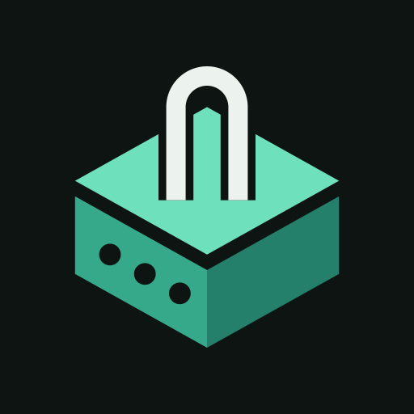
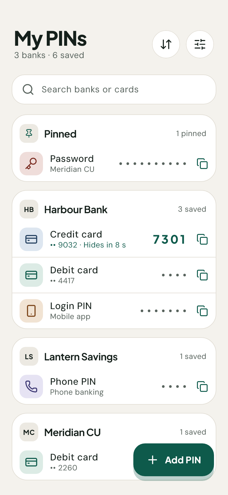
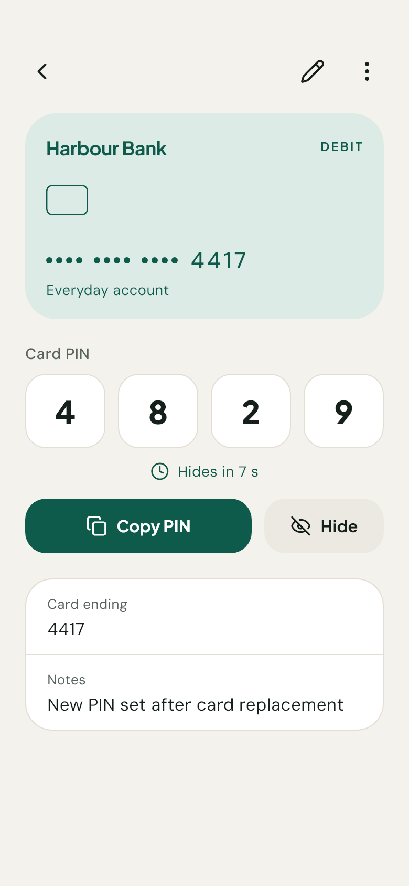
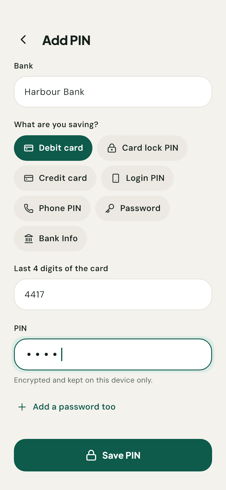
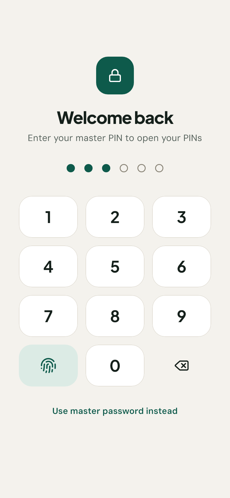
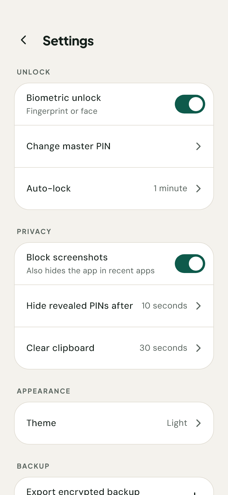
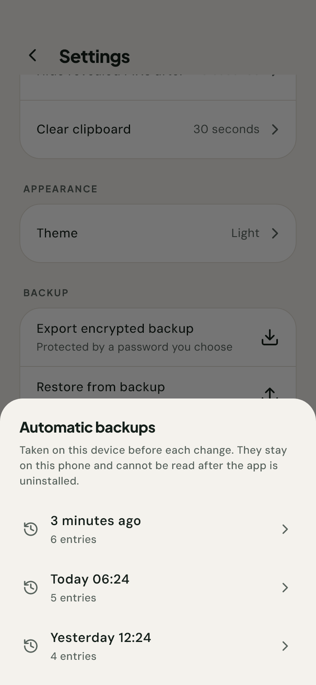

<p align="center">
  
</p>

<h1 align="center">Pinbox</h1>

<p align="center">
  <b>A minimal, offline vault for bank card PINs, login PINs and banking passwords.</b>
</p>

<p align="center">
  
  
  
  <a href="LICENSE"></a>
  
  
</p>

<p align="center">
  <picture>
    <source media="(prefers-color-scheme: dark)" srcset="docs/screenshots/2_dark.png">
    
  </picture>
  <picture>
    <source media="(prefers-color-scheme: dark)" srcset="docs/screenshots/3_dark.png">
    
  </picture>
  <picture>
    <source media="(prefers-color-scheme: dark)" srcset="docs/screenshots/4_dark.png">
    
  </picture>
</p>
<p align="center">
  <picture>
    <source media="(prefers-color-scheme: dark)" srcset="docs/screenshots/1_dark.png">
    
  </picture>
  <picture>
    <source media="(prefers-color-scheme: dark)" srcset="docs/screenshots/5_dark.png">
    
  </picture>
  <picture>
    <source media="(prefers-color-scheme: dark)" srcset="docs/screenshots/6_dark.png">
    
  </picture>
</p>

Pinbox keeps the numbers you're not supposed to write down: card PINs, app login
PINs, phone unlock codes, banking passwords and account details. It lives on your
phone and nowhere else. The release build doesn't even ask for the internet
permission, so there's no account, no sync, no server, and nothing to leak.

---

## Contents

- [Features](#features)
- [Usage](#usage)
- [How it stays safe](#how-it-stays-safe)
- [Install](#install)
- [Building from source](#building-from-source)
- [Project layout](#project-layout)
- [Changelog](#changelog)
- [License](#license)

## Features

- **Seven kinds of entry** — debit card, credit card, card lock PIN, login PIN, phone
  PIN, password, and bank info (account name and number, BSB/IFSC, CIF). Entries
  group themselves by bank, and search covers banks, entry types, nicknames,
  account names and card endings — never the secrets themselves.
- **Masked until you ask** — PINs, account numbers and CIF numbers stay hidden until
  revealed, and hide themselves again after a few seconds.
- **Master PIN, password fallback, biometrics** — a 6-digit PIN to open the app, a
  longer master password for when you need it, and optional fingerprint or face.
- **Automatic backups** — an encrypted copy of the previous state is kept before
  every change, so a deletion or a bad edit can be undone.
- **Encrypted export** — a portable backup file, protected by a password you choose,
  for when the phone itself is lost.
- **Private by design** — blocked screenshots, a blank recent-apps thumbnail, a
  clipboard that wipes itself, and auto-lock when you leave.
- **Light and dark** — follows the system, or set it yourself.

## Usage

### First run
Pinbox asks you to **Create your PIN** (6 digits, entered twice) and then **Add a
master password** of at least 8 characters that differs from the PIN. The password
is your way back in if you ever can't use the PIN. If your phone has biometrics
enrolled, fingerprint or face unlock is switched on for you; you can turn it off in
Settings.

### Adding an entry
Tap **Add PIN**, pick what you're saving, and fill in the bank and the secret.
Cards take the last four digits so you can tell them apart. While adding a PIN,
**Add a password too** opens a second field, so that bank's password is saved
alongside it as its own entry.

### Reading and copying
Tap an entry to open it. **Reveal** shows the secret for a few seconds; the copy
button puts it on the clipboard, which Pinbox clears again after 30 seconds by
default. On the list, tapping a row's dots peeks at it without opening it.

### Locking
Pinbox locks itself after a minute in the background (adjustable in **Settings ›
Auto-lock**). Locking drops everything decrypted from memory and closes whatever was
open. To unlock, use the PIN, your fingerprint or face, or **Use master password
instead**.

### Backups
- **Automatic backups** happen on their own. To undo a deletion or an edit, open
  **Settings › Automatic backups**, pick a point in time, and confirm. The current
  state is kept as a backup too, so restoring the wrong one is recoverable. These
  stay on the phone and can't be read after an uninstall.
- **Export encrypted backup** writes a file protected by a password you choose and
  hands it to the share sheet, so you can keep it somewhere off the phone.
  **Restore from backup** reads one back in and merges it with what's already
  there.

> Keep an exported backup somewhere safe. It's the only copy that survives losing
> or resetting the phone.

### If you forget
Forgot the PIN? Choose **Use master password instead** on the unlock screen, then
set a new one in **Settings › Change master PIN**, which also accepts the master
password as proof. If both the PIN and the password are gone, the data can't be
opened, by you or by anyone else. There is no reset.

## How it stays safe

| Concern | Approach |
| --- | --- |
| Data at rest | Every entry lives in one AES-256-GCM encrypted file (`vault.bin`). The random 256-bit key is held in the Android Keystore / iOS Keychain, never beside the file. |
| Master PIN / password | Stored only as salted PBKDF2-HMAC-SHA256 hashes (600k iterations), compared in constant time. |
| Guessing | Five free tries, then a 30 s wait that doubles up to an hour, shared across PIN and password. Each guess is recorded *before* it's checked, so force-quitting can't erase it; on Android, waits run on the boot clock, so changing the date or rebooting can't cut one short. |
| Automatic backups | Byte-for-byte copies of the encrypted vault in app-private storage, under the same keystore key. No plaintext and no second password; wiped along with the vault. |
| Exported backups | Encrypted under a password chosen at export time — *not* the 6-digit PIN, which is too small a space to protect a file that can be copied off the phone. Files that ask for too few or too many key-derivation rounds are refused. |
| Screen capture | Android `FLAG_SECURE`, which also blanks the recent-apps thumbnail; iOS covers the UI in the app switcher. |
| Clipboard | Copies are flagged sensitive on Android 13+ and cleared after a delay (default 30 s). |
| Leaving the device | No internet permission. Excluded from Android cloud backup *and* from device-to-device transfer. |
| Auto-lock | Re-locks after a configurable time in the background; locking replaces the whole navigation stack, so nothing typed or revealed survives it. |

### What it doesn't protect against

Being specific about the limits is part of the design:

- **A rooted or compromised phone.** The vault key is guarded by the operating
  system's keystore, and the master PIN controls access to the app rather than
  forming part of that key. Code running with Pinbox's own privileges could read
  entries without the PIN.
- **Someone watching you type.** The PIN pad is a PIN pad.
- **Clipboard readers.** While a copied secret sits on the clipboard, apps allowed to
  read it can. If Android kills Pinbox before the wipe, the value stays until the
  system clears it (Android 13+ does so after about an hour).
- **iOS clock changes.** iOS has no equivalent of Android's boot clock, so there the
  lockout is timed on the wall clock.

## Install

Pinbox is not on an app store yet; an F-Droid release is planned.

Until then, build it from source as below. Releases will carry a signed APK once
they're published.

## Building from source

Requires Flutter 3.47 (Dart 3.13) and the Android SDK.

```bash
git clone https://github.com/SarveshP16/pinbox.git
cd pinbox
flutter pub get
flutter test
flutter build apk --release
```

Without a signing key, release builds fall back to the debug key. To sign with
your own, create `android/key.properties` pointing at a keystore (`storeFile`,
`storePassword`, `keyAlias`, `keyPassword`). It's gitignored, as is any `*.jks`.

`flutter test test/preview_test.dart --update-goldens` renders every screen, light
and dark, to `test/preview/`. That's where the screenshots above come from.

## Project layout

```
lib/
  app/        router (lock state drives navigation), lifecycle shell
  core/       theme, shared widgets, crypto, platform bridges
  features/
    lock/     unlock, first-run setup, lockout policy
    vault/    entries, list, detail, add/edit
    settings/ settings + change master PIN
    backup/   encrypted export/restore, automatic snapshots
```

One feature, many small files: each widget or pure function lives in its own file.

### Known limitations

- iOS is written for but **unverified**: there was no Mac in the development
  environment.
- `cryptography_flutter` (native-speed PBKDF2) still applies the old Kotlin Gradle
  Plugin; Flutter warns that future versions will refuse such plugins.

## Changelog

What changed and when: [CHANGELOG.md](CHANGELOG.md). Store release notes live in
`fastlane/metadata/android/en-US/changelogs/`.

## License

Pinbox is free software, licensed under the **GNU General Public License v3.0 or
later** — see [LICENSE](LICENSE). You may use, study, share and modify it; if you
distribute a modified version, it has to stay under the same license.

| Component | License |
| --- | --- |
| Pinbox source | [GPL-3.0-or-later](LICENSE) |
| Plus Jakarta Sans, DM Sans (bundled fonts) | SIL Open Font License 1.1 — [text](assets/fonts/PlusJakartaSans-OFL.txt), [text](assets/fonts/DMSans-OFL.txt) |
| [Lucide](https://lucide.dev) icons | ISC |

Privacy: [PRIVACY.md](PRIVACY.md). Releasing to GitHub, F-Droid and Play:
[docs/PUBLISHING.md](docs/PUBLISHING.md).
